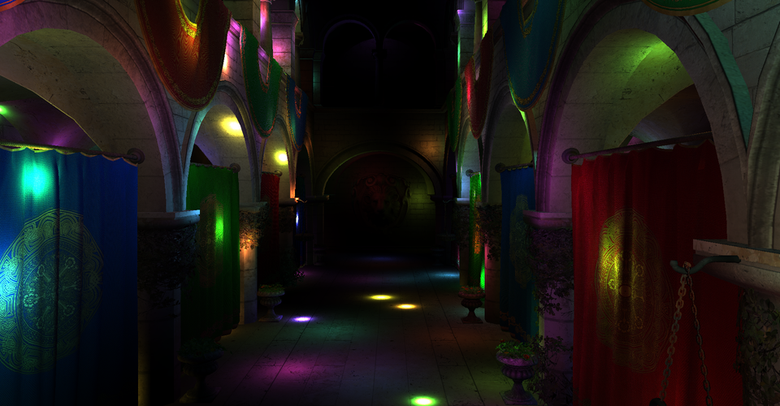
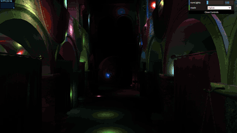
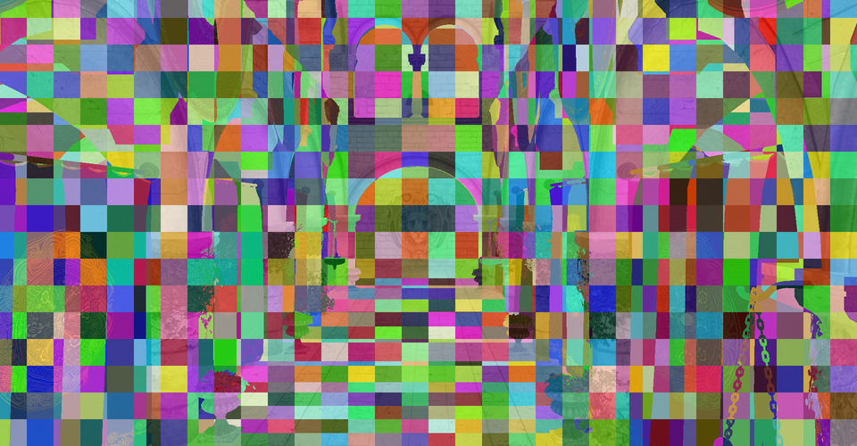
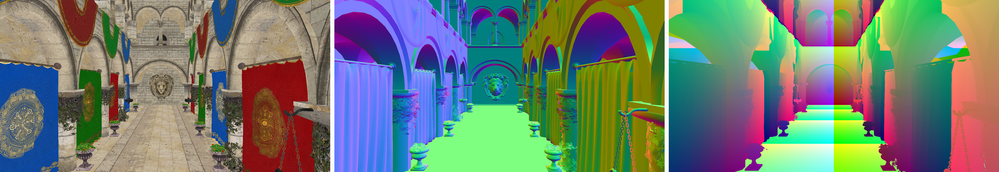
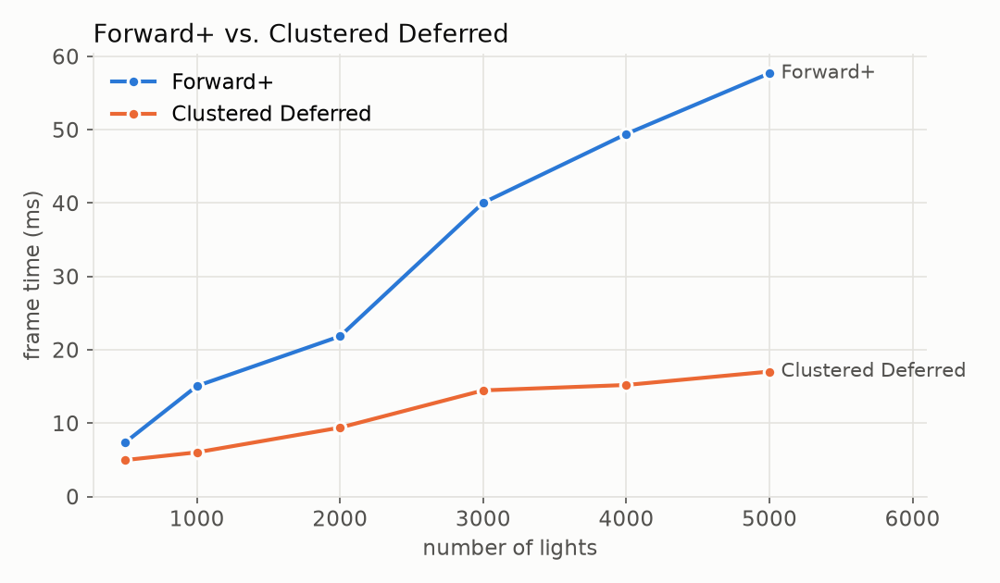
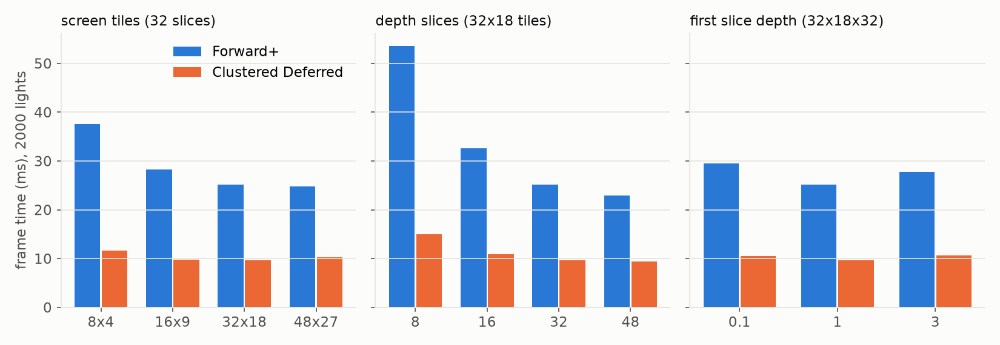
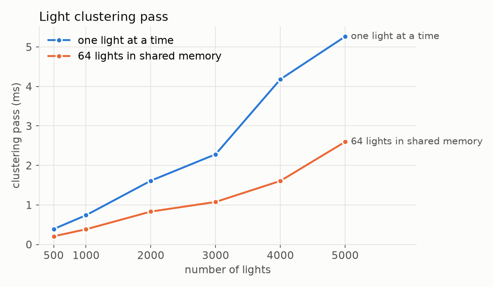
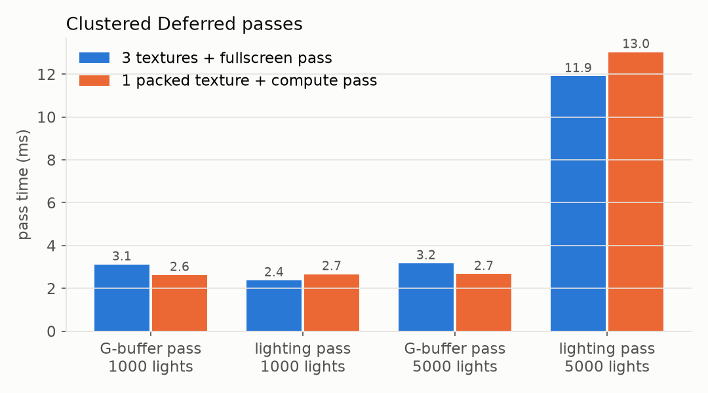

WebGL Forward+ and Clustered Deferred Shading
======================

**University of Pennsylvania, CIS 565: GPU Programming and Architecture, Project 4**

* Chen Cheng
  * [LinkedIn](https://www.linkedin.com/in/chen-andrew-cheng-34a133229/), [GitHub](https://github.com/ischencheng)
* Tested on: **Google Chrome 155** on Windows 11, i5-12500H @ 2.50GHz 16GB, NVIDIA GeForce RTX 2050 4GB (personal laptop)

### Live Demo

### Demo Video/GIF

### Description

This project renders the Sponza atrium lit by up to 5000 moving point lights in WebGPU. Each light only reaches 2 units, so a pixel only needs the few lights near it. The GUI switches between three renderers:

* Naive: every fragment loops over every light
* Forward+: a compute shader sorts the lights into clusters, and every fragment only loops over the lights of its cluster
* Clustered Deferred: the same clusters, but the scene is drawn into a G-buffer first and then lit once per pixel

For extra credit I made the G-buffer one packed texture with a compute lighting pass.

### Naive

The naive renderer draws the scene once and every fragment loops over all the lights. I only had to give it the camera: the view-projection matrix goes into a uniform buffer in `camera.ts`, the buffer goes into the bind group in `naive.ts`, and `naive.vs.wgsl` multiplies each vertex by it. It is very slow with many lights, because every pixel checks every light, and pixels that are hidden behind other geometry later check them too.

### Forward+

Forward+ cuts the view frustum into a 3D grid of clusters: 32 x 18 tiles on the screen, and 32 slices in depth. A compute shader (`clustering.cs.wgsl`) runs one thread per cluster. The thread builds the cluster's bounding box in view space, tests every light's sphere against the box, and writes the indices of the lights that touch it. In the fragment shader, each fragment finds its cluster from its pixel position and depth, and only loops over that cluster's lights. In the picture above I temporarily made the fragment shader output a color for each cluster index.

The depth slices are spaced in log scale, so the near slices are thin and the far slices are thick. Slice 0 goes from the camera to depth 1, because almost nothing is that close to the camera. The other 31 slices go from 1 to 50 (the whole scene fits in 50), and slice $k$ starts at

$$z_k = 50^{\frac{k-1}{31}}, \quad k = 1, \dots, 31$$

Each cluster can hold 1023 light indices, so the cluster buffer is 32 x 18 x 32 x 1024 x 4 bytes = 75 MB. With 5000 lights the busiest cluster on screen has about 800 lights, so no light gets cut off.

This heat map shows how many lights the cluster of each pixel has with 5000 lights (blue is few, red is 400 or more). The lights only move inside a box in the middle of the atrium (x from -10 to 10). The arches near the camera are inside this box, so they are red, and the end of the hall is outside of it, so it is blue.

### Clustered Deferred

The deferred renderer reuses the same clustering pass. First a G-buffer pass draws the scene and only writes the albedo (`rgba8unorm`), the normal and the world position (`rgba16float`) of the closest surface (above, from left to right). Then a fullscreen pass reads these three textures and does the same cluster lighting as Forward+. This way each pixel is lit exactly once, no matter how many surfaces were drawn on top of each other. The G-buffer extra credit below packs all of this into one texture.

### Performance Analysis

I measured everything in Chrome at 1920 x 1080 with the default camera, which looks down the middle of the atrium. Chrome was started with `--disable-gpu-vsync --disable-frame-rate-limit`, so the frame rate is not capped at 60 fps. The frame time is the time between two frames finishing on the GPU (`device.queue.onSubmittedWorkDone()`), averaged over 120 frames (only 3 to 8 frames for naive, which is very slow), and the time of each pass comes from timestamp queries. I ran every setting 3 times and kept the middle one. The lights keep moving while I measure, so the numbers still change by about 5% between runs. The tables in this section are from the renderers without the extra credit, and the extra credit sections compare with them.

This table shows the frame time (ms) for different numbers of lights:

| Lights | Naive | Forward+ | Clustered Deferred |
|---|---|---|---|
| 500 | 140.9 | 7.4 | 5.0 |
| 1000 | 281.5 | 15.1 | 6.0 |
| 2000 | 563.4 | 21.8 | 9.4 |
| 3000 | 845.5 | 40.0 | 14.5 |
| 4000 | 1129.2 | 49.4 | 15.2 |
| 5000 | 1409.8 | 57.7 | 17.0 |

Naive grows linearly with the number of lights, about 28 ms for every 100 lights, because every fragment loops over all of them. Both clustered renderers are 20 to 80 times faster, because a pixel only looks at the lights of its cluster.

This table shows the time of each pass (ms):

| Pass | Forward+ 1000 lights | Forward+ 5000 lights | Deferred 1000 lights | Deferred 5000 lights |
|---|---|---|---|---|
| light clustering | 0.41 | 2.38 | 0.36 | 2.38 |
| G-buffer | | | 3.12 | 3.17 |
| shading | 11.42 | 52.23 | 2.36 | 12.03 |

### Forward+ vs. Clustered Deferred

Compare your implementations of Forward+ and Clustered Deferred shading and analyze their differences.

* **Is one of them faster?**
  * Yes, Clustered Deferred is faster at every light count I tried: 1.5 times faster at 500 lights and 3.4 times faster at 5000 lights.

* **Is one of them better at certain types of workloads?**
  * Clustered Deferred is better when there are many lights and many surfaces on top of each other, like Sponza with its columns, curtains and plants. Forward+ does fine when there are few lights, because then shading is cheap and the extra G-buffer pass is not worth much: at 500 lights the gap is only 2.4 ms. Forward+ also suits scenes with transparent objects or many different materials better.

* **What are the benefits and tradeoffs of using one over the other?**
  * Deferred lights each pixel once, so its shading cost depends on the screen size and the lights per cluster, not on how many triangles cover a pixel. The tradeoff is memory and bandwidth: my G-buffer has 20 bytes per pixel (about 40 MB at 1080p) that is written and read again every frame, and every material has to fit into the same few values. It also keeps only the closest surface, so transparent objects and MSAA don't work with it directly. Forward+ needs no extra textures and each object can use any shader, but it also shades fragments that get hidden later.

* **For any differences in performance, briefly explain what may be causing the difference.**
  * The pass table shows the reason. Both renderers use the same clusters, but at 5000 lights Forward+ spends 52 ms in its shading pass and Deferred only 12 ms. Forward+ runs the light loop for every fragment that passes the depth test when it is drawn, even if a closer surface covers it later. From the 4 to 5 times longer shading pass I think each pixel is shaded about 4 times on average. Deferred runs the light loop once per pixel, after the G-buffer pass has already found the closest surface. The G-buffer pass costs about 3 ms, which is why the gap is small at 500 lights.

The best case for both is many small lights, where each cluster only needs a few of them. The worst case is a few huge lights that touch every cluster: then each pixel still loops over all lights, and the clustering pass is extra work on top. The heat map above also matches the timing: the red pixels near the camera loop over many more lights than the blue ones at the end of the hall, and with more lights the red area grows.

### Cluster Size

I changed the number of clusters in three ways with 2000 lights (the cluster buffer here holds 511 lights per cluster, which is still enough at 2000 lights). This table shows the frame times (ms), the clustering pass (ms) and how many lights the cluster of a pixel has on average:

| Clusters | Forward+ | Deferred | Clustering pass | Lights per cluster |
|---|---|---|---|---|
| 8 x 4 tiles, 32 slices | 37.6 | 11.6 | 0.17 | 163 |
| 16 x 9 tiles, 32 slices | 28.3 | 9.8 | 0.19 | 121 |
| 32 x 18 tiles, 32 slices | 25.1 | 9.6 | 0.69 | 101 |
| 48 x 27 tiles, 32 slices | 24.8 | 10.3 | 1.47 | 85 |
| 32 x 18 tiles, 8 slices | 53.5 | 15.0 | 0.23 | 222 |
| 32 x 18 tiles, 16 slices | 32.6 | 10.9 | 0.31 | 139 |
| 32 x 18 tiles, 48 slices | 22.9 | 9.4 | 0.98 | 86 |
| first slice at 0.1 | 29.5 | 10.6 | 0.69 | 119 |
| first slice at 3 | 27.7 | 10.7 | 0.59 | 124 |

Smaller clusters have fewer lights in them, so shading gets faster, but there are more clusters to fill, so the clustering pass gets slower and the buffer gets bigger. With 48 x 27 tiles the clustering pass takes 1.5 ms, which is more than Deferred saves in shading. The depth slices matter more than the tiles, because with only 8 slices the far slices are many units deep and a light anywhere in that depth range counts. 48 slices are a bit faster than 32, but with 1023 lights per cluster the buffer would be 113 MB, close to WebGPU's 128 MB limit for one storage buffer, so I kept 32 x 18 x 32.

The first slice depth is the other setting I tuned. With plain log slices that start at the near plane (0.1), the first slices are tiny and empty, because nothing in Sponza is that close to the camera, and the other slices get thicker. Making slice 0 cover everything closer than 1 brought Forward+ from 29.5 ms to 25.1 ms and Deferred from 10.6 ms to 9.6 ms. Starting at 3 is worse again, because the walls next to the camera are about 2 to 3 units away and all of them fall into slice 0.

### Optimization: Light Clustering in Shared Memory

In my first clustering shader each thread looped over all lights by itself, so every thread read every light from the storage buffer and multiplied it by the view matrix. Now the 64 threads of a workgroup load 64 lights together: each thread reads one light, moves it to view space and puts it into workgroup (shared) memory, then after a barrier all threads test those 64 lights. This cuts the light reads and matrix multiplies by 64 times.

This table shows the clustering pass (ms) before and after:

| Lights | 500 | 1000 | 2000 | 3000 | 4000 | 5000 |
|---|---|---|---|---|---|---|
| one light at a time | 0.39 | 0.74 | 1.61 | 2.28 | 4.18 | 5.26 |
| 64 lights in shared memory | 0.21 | 0.38 | 0.83 | 1.08 | 1.61 | 2.60 |

It is about 2 times faster, which saves 2.7 ms per frame at 5000 lights. It is not 64 times faster because the sphere-box test for each light and cluster is still the same amount of work. To make it faster I would cull the lights per screen tile first, or only fill the clusters that actually have visible geometry in them.

### Extra Credit: G-buffer Optimization

I did both parts. The G-buffer is now one `rg32uint` texture with 8 bytes per pixel (it was 20 bytes in three textures), and the lighting pass is one compute shader instead of the fullscreen vertex + fragment pass.

* Albedo: `pack4x8unorm` puts it into the first `u32`.
* Normal: octahedron encoding projects the unit normal onto an octahedron and folds the lower half up, so it becomes two numbers in [-1, 1]. `pack2x16snorm` puts them into the second `u32`.
* Position: not stored at all. The compute shader reads the depth buffer and multiplies the pixel's NDC position by the inverse view-projection matrix.

The compute shader runs one thread per pixel in 8 x 8 workgroups and writes straight into the canvas texture as a storage texture. For this the canvas uses `rgba8unorm` with the `STORAGE_BINDING` usage, because the default `bgra8unorm` can't be a storage texture without an extra feature.

This table shows the frame time (ms) before and after:

| Lights | 500 | 1000 | 2000 | 3000 | 4000 | 5000 |
|---|---|---|---|---|---|---|
| 3 textures + fullscreen pass | 5.0 | 6.1 | 9.8 | 13.6 | 16.6 | 17.2 |
| 1 packed texture + compute pass | 4.7 | 5.8 | 9.6 | 14.5 | 16.7 | 17.7 |

The G-buffer pass got about 16% faster (3.1 ms to 2.6 ms), because it writes 8 bytes per pixel instead of 20. But my compute lighting pass is about 10% slower than the fullscreen fragment pass (11.9 ms to 13.0 ms at 5000 lights), so the frame time stayed about the same: a bit faster with few lights, a bit slower with many. I tried 4 x 4, 8 x 8 and 16 x 16 workgroups: 4 x 4 was twice as slow and the other two were the same. I am not sure why the compute pass is slower. I think the depth unprojection and the normal decode add a little work per pixel, and the fragment shader gets its pixels from the rasterizer in an order that the GPU is already tuned for.

So the best case for this optimization is a high resolution with few lights, where reading and writing the G-buffer is a big part of the frame. The worst case is many lights, where the light loop is almost all of the time and the smaller G-buffer can't help it. The tradeoff is precision: albedo has 8 bits per channel (the same as the textures), the normal has 16 bits per component, and the position is only as exact as the depth buffer. Compared with the naive renderer, the biggest difference I found in a frame was 16 out of 255 on a few pixels. To make it faster I would let the 64 threads of a workgroup load their cluster's lights into shared memory together, because the pixels of an 8 x 8 tile mostly fall into the same cluster.

### Credits

- [Vite](https://vitejs.dev/)
- [loaders.gl](https://loaders.gl/)
- [dat.GUI](https://github.com/dataarts/dat.gui)
- [stats.js](https://github.com/mrdoob/stats.js)
- [wgpu-matrix](https://github.com/greggman/wgpu-matrix)
